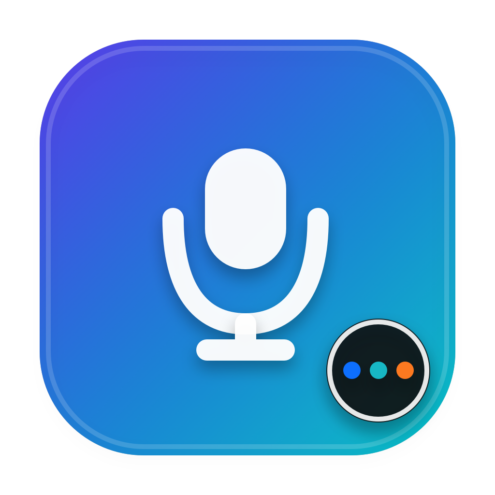

# MicLock for macOS

  

MicLock keeps the macOS global default input device on your MacBook's built-in
microphone while allowing AirPods or another headset to remain the output
device.

[简体中文](README.zh-CN.md)

## Why

AirPods may become the default input whenever they reconnect. That activates
the Bluetooth hands-free audio path and can reduce playback quality. MicLock
continuously restores the preferred microphone without changing the output
device.

## Features

- Native macOS menu-bar app with no Dock icon.
- Global default-input enforcement for apps that use “System Default”.
- Built-in microphone, AirPods/Bluetooth, other-device, and unavailable badges.
- Automatic menu-bar contrast while the device badge remains colored.
- Command-line controls for status, selection, pause, resume, and logs.
- Per-user LaunchAgents; no root daemon and no <code>sudo</code>.
- No network access, analytics, or audio recording.

## Compatibility

- macOS Tahoe 26 or later.
- Apple Silicon.
- Source installation uses
  [SwitchAudioSource](https://github.com/deweller/switchaudio-osx) 1.2.2 through
  Homebrew.

## Install the release

1. Download the latest DMG from
   [GitHub Releases](https://github.com/liuzhengyi/miclock-macos/releases/latest).
2. Open the DMG and run <code>安装 MicLock.command</code>.
3. MicLock appears in the menu bar and can also be launched with Spotlight by
   searching for <code>MicLock</code>.

The current community build is ad-hoc signed and not Apple-notarized. If
Gatekeeper blocks first launch, Control-click <code>MicLock.app</code>, choose
**Open**, and confirm. Review the source before installing.

## Install from source

~~~zsh
git clone https://github.com/liuzhengyi/miclock-macos.git
cd miclock-macos
chmod +x *.sh miclock
./install.sh
./install-menu-app.sh
~~~

<code>install.sh</code> installs <code>switchaudio-osx</code> with Homebrew
when needed, detects the built-in microphone, installs the background
LaunchAgent, and verifies the selected device.

To choose a device explicitly:

~~~zsh
SwitchAudioSource -a -t input
./install.sh --device "MacBook Air Microphone"
~~~

## Command line

The installer adds these commands to <code>~/.local/bin</code>:

~~~zsh
mic-status                         # Service, target, and current input
mic-list                           # List input devices
mic-pick                           # Select a target interactively
mic-set "Device Name"              # Select and enforce a target
mic-fix                            # Correct the input immediately
mic-off                            # Pause automatic enforcement
mic-on                             # Resume automatic enforcement
mic-quit                           # Stop enforcement; restore macOS behavior
mic-start                          # Start enforcement again
miclock logs                       # Show recent logs
~~~

If <code>~/.local/bin</code> is not on your shell path:

~~~zsh
echo 'export PATH="$HOME/.local/bin:$PATH"' >> ~/.zshrc
source ~/.zshrc
~~~

## Menu-bar states

| Badge | Meaning |
| --- | --- |
| Blue <code>M</code> | MacBook built-in microphone |
| Teal <code>A</code> | AirPods or another Bluetooth microphone |
| Orange <code>O</code> | Other or virtual input device |
| Red <code>!</code> | No input device is available |

The filled microphone means enforcement is active. The outlined microphone
means it is paused. Click the icon to switch devices or restore normal macOS
behavior.

## How it works

MicLock installs two per-user LaunchAgents:

- <code>com.user.mic-input-lock</code> checks the current CoreAudio default
  input every two seconds and restores the configured device when necessary.
- <code>com.user.mic-input-lock-menu</code> runs the AppKit menu-bar interface.

Configuration and logs live in:

~~~text
~/.config/mic-input-lock/
~/Library/LaunchAgents/com.user.mic-input-lock*.plist
~/Library/Logs/mic-input-lock*.log
~~~

MicLock changes only the global default input. An app that explicitly selects
its own microphone can override the system default; choose “System Default” in
that app.

## Build a DMG

~~~zsh
brew install switchaudio-osx
./build-dmg.sh
~~~

The DMG embeds the Apple Silicon <code>SwitchAudioSource</code> executable and
its MIT license so recipients do not need Homebrew. A production release
should replace ad-hoc signing with Developer ID signing, Hardened Runtime, and
Apple notarization.

## Uninstall

From a release DMG, run <code>卸载 MicLock.command</code>. From source:

~~~zsh
./uninstall-menu-app.sh
./uninstall.sh --purge-logs
~~~

## Privacy and security

MicLock does not capture microphone audio. It only reads available CoreAudio
device metadata and changes the system default input. It contains no network
client, telemetry, updater, or analytics SDK.

## Contributing

Issues and pull requests are welcome. See [CONTRIBUTING.md](CONTRIBUTING.md).

## License

MicLock is released under the [MIT License](LICENSE).
<code>SwitchAudioSource</code> is a separate MIT-licensed project; its license
is bundled with release builds.
